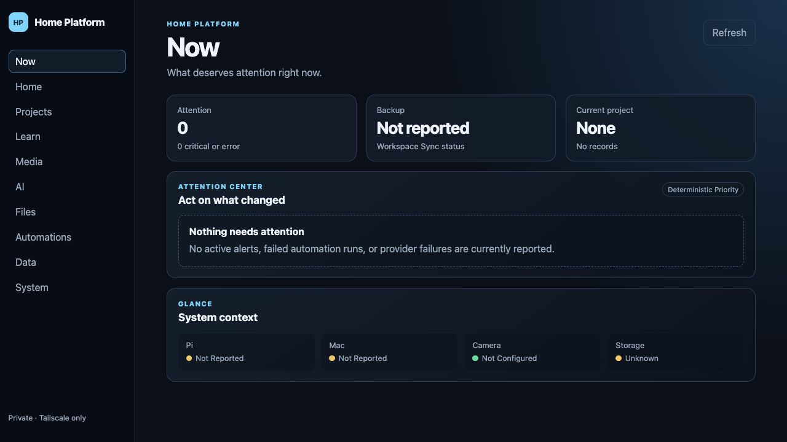

# home-platform-dashboard

<!-- WORKSPACE-VERIFICATION:START -->
## Current state and getting started

Updated 2026-10-05. Component of **Home Lab**. Home Platform is a private, Tailscale-only control interface and Control Plane

### Startup state

| App | Platform | Result |
|---|---|---|
| home-platform-dashboard | web | opened |

These are startup observations; simulated flows and production acceptance remain unverified.

### Install and start

#### home-platform-dashboard — web

Purpose: Home Platform is a private, Tailscale-only control interface and Control Plane

Requirements: Node.js, the declared package manager and any backend/services in the existing configuration.

Install and start from this project root:

```sh
cd .
npm install --package-lock=false
npm run dev -- --hostname 127.0.0.1 --port 4342
```

Audit entry URL: [http://127.0.0.1:4342](<http://127.0.0.1:4342>). Restart the server before reopening it; use any configured base path shown in this URL.

Expected result: the local server prints its URL and renders the home-platform-dashboard interface. Earlier audit servers may have been stopped after capture.

### home-platform-dashboard / web screenshot



### Next steps

See [the parent project README](<../../README.md>) for canonical Better Workspace task IDs and the matched Notion row.

- **home-platform-dashboard / web:** Turn this candidate into a fixture-backed simulated flow with explicit assertions and capture its result.

Detailed continuation: [next steps](<docs/NEXT_STEPS.md>). No archive or release operation was performed.
<!-- WORKSPACE-VERIFICATION:END -->

