# kiosk-lab: the whole Pi at a glance

`kiosk-lab` (Raspberry Pi 5, Debian 13, Tailscale IP `100.90.61.70`,
`kiosk-lab.tailef7acc.ts.net`) is a **shared host**, not a single
application. Two independent systems run on it:

1. **Workspace Sync & Backup Utility** -- owns physical storage: disks,
   UUID-based mounts, workspace storage state, the backup HDD, Syncthing.
   Repo: `Workspace Sync & Backup Utility/`.
2. **Bidirectional Project Hub** (part of the broader **home-platform**
   stack) -- owns project metadata, Notion sync, jobs, Mac-agent
   communication, project-facing APIs. Repo: `Home Lab/home-platform/`
   (the `Bidirectional Project Hub/` folder is just a pointer to here).
Neither of the first two projects reads the other's database, config,
mounts, or state files. Where they need to know about each other, they use
one narrow HTTP contract (below) -- never filesystem assumptions, never
direct DB coupling.

## Architecture

```mermaid
flowchart TB
    subgraph Mac["Mac (zacharys-macbook-pro)"]
        MacWS["~/Workspace\n(real files)"]
        MacBridge["Workspace Mac Bridge\nlaunchd: com.workspace.macbridge\n:8788, allowlisted commands"]
        Watcher["Workspace Watcher\nlaunchd: com.zacharysturman.workspace-watcher\nSQLite events.db"]
        NodeAgent["Project Hub Mac Node\nlaunchd: com.homeplatform.node\nMQTT + HTTP poll"]
        SyncthingMac["Syncthing (Mac)\n:8384 localhost only"]
        MacWS --> Watcher
        MacWS --> SyncthingMac
        NodeAgent -->|reads read-only| Watcher
        NodeAgent -->|creates/initializes projects in| MacWS
    end

    subgraph Pi["Raspberry Pi (kiosk-lab, 100.90.61.70)"]
        subgraph WSU["Workspace Sync & Backup Utility (owns storage)"]
            Dashboard["Dashboard\nsystemd: workspace-dashboard\n:8787 Tailscale-only"]
            DiskGuard["disk-guard units\n(fail closed)"]
            Backup["restic backup\ntimers: hourly/daily/weekly"]
            SyncthingPi["Syncthing (Pi)\nfolders: workspace (PROD, paused),\nworkspace-test (SD card, active)"]
            TestWS["/opt/workspace-util/test-workspace\n(bounded, SD card)"]
            ProdWS["/mnt/workspace/Workspace\n(future SSD/NVMe -- PENDING)"]
            BackupHDD["/mnt/workspace-backup\n4.6TB HDD, UUID 653E-F09E"]
        end
        subgraph HP["home-platform-next (Docker Compose, owns coordination)"]
            Postgres[("Postgres\ninternal only")]
            Mosquitto["Mosquitto\n:1883 Tailscale-bound, authenticated"]
            Core["control-plane-core\nNotion sync + reconciliation"]
            API["control-plane-api\n:8080 internal only"]
            Automation["automation-controller"]
            NextDash["Next.js dashboard\n127.0.0.1:3000"]
        end
        Serve["Tailscale Serve\nkiosk-lab.tailef7acc.ts.net -> :3000"]

        Dashboard --> DiskGuard --> BackupHDD
        Dashboard --> SyncthingPi
        DiskGuard -.->|would guard| ProdWS
        SyncthingPi -.paused.-> ProdWS
        SyncthingPi --> TestWS
        Backup --> BackupHDD
        Core --> Postgres
        Core --> Mosquitto
        API --> Postgres
        API --> Mosquitto
        Automation --> Postgres
        NextDash --> API
        Serve --> NextDash
    end

    Notion["Notion Projects DB"]
    HomeLabControl["HomeLab Control\n(macOS/iOS app)"]

    SyncthingMac <-->|Tailscale, folders: workspace, workspace-test| SyncthingPi
    MacBridge <-->|Tailscale, allowlisted commands| Dashboard
    NodeAgent <-->|MQTT + HTTP poll, Tailscale| Mosquitto
    NodeAgent <--> API
    Core <-->|Notion API| Notion
    HomeLabControl -->|HTTPS| Serve
    API -->|GET /api/storage/contract\nTHE inter-project contract| Dashboard

    style WSU fill:#1a3a1a,stroke:#4a8a4a
    style HP fill:#1a1a3a,stroke:#4a4a8a
```



## The inter-project contract

**Project Hub never inspects `/dev`, UUIDs, `/etc/fstab`, mount tables, or
Workspace Sync's own config/state files.** It calls one endpoint:

```
GET http://100.90.61.70:8787/api/storage/contract   (Workspace Sync's dashboard)
GET http://<pi>:8080/api/v1/storage/status           (Project Hub's own proxy of the above, for HomeLab Control)
```

```json
{
  "mode": "production | test | pending",
  "production_sync_safe": true,
  "workspace_disk_mounted": true,
  "workspace_root": "/mnt/workspace/Workspace",
  "syncthing_workspace_folder": "paused | active | unknown",
  "storage_health": "ok | warning | error",
  "storage_health_detail": "...",
  "project_directory_creation_allowed": true,
  "detail": "..."
}
```

Implemented in `workspace_util.workspace_state.build_storage_contract`
(Workspace Sync) and consumed by `app.workspace_contract`
(Project Hub/home-platform). Auth: the same `X-Workspace-Token` bearer token
the dashboard already uses, copied once into
`home-platform-next/secrets/workspace_contract_token`. Every call on the
Project Hub side is best-effort and degrades to `mode: "unknown"` on any
failure -- it never raises, so a storage outage cannot take down Notion
sync, reconciliation, or the API.

**Symmetrically, Workspace Sync & Backup Utility never reads Project Hub's
Postgres tables or Notion data.** It has no code path that touches either.

### Project creation while production storage is unavailable

`POST /api/v1/projects` already separates metadata from physical creation:
the Postgres row + Notion page are created and returned immediately (202),
while the actual directory is a `queued` job dispatched to
`workspace_node_id` (today always the Mac's own node, which has its own
always-available real disk) and executed asynchronously with its own
poll-based retry. **This means project creation cannot write onto the Pi's
SD card today, structurally** -- not because of a runtime check, but
because the node that ever creates directories is the Mac. If a
Pi-resident workspace node is ever added, its command handler MUST call
`workspace_contract.is_directory_creation_allowed_for_node(node_id)` first
and leave the command `queued` (never fall back to the bounded SD-card
path) when it returns `False`. See `docs/project-hub.md` for the full
reasoning.

## Every service on kiosk-lab

| Service | Owner | Process/container | Port | Protocol | Filesystem | Startup | Health check | Secrets | External? | Tailscale? | If unavailable |
|---|---|---|---|---|---|---|---|---|---|---|---|
| Dashboard | Workspace Sync | `workspace-dashboard.service` (systemd) | 8787 | HTTP | `/opt/workspace-util`, `/etc/workspace-util` | systemd, enabled, `Restart=on-failure` | `GET /api/health` | `WORKSPACE_DASHBOARD_TOKEN` (optional bearer) | No (Tailscale-IP bind only) | Yes | Phone UI and Project Hub's storage contract degrade to "unknown"; backups/timers unaffected (separate processes) |
| Disk guards | Workspace Sync | `workspace-disk-guard`, `workspace-backup-disk-guard` (systemd, oneshot) | -- | -- | `/mnt/workspace`, `/mnt/workspace-backup` | systemd, on-demand (`Requires=` by backup units) | exit code | -- | n/a | n/a | Backup/sync refuse to run rather than fall back to SD card |
| Backup (restic) | Workspace Sync | `workspace-backup*.{service,timer}` (systemd) | -- | -- | `/mnt/workspace-backup` (HDD, UUID `653E-F09E`) | systemd timers, enabled (hourly/daily/weekly) | `last_integrity_check.json` marker, snapshot listing | `WORKSPACE_BACKUP_PASSWORD` | No | n/a | Backups pause; HDD unmount is fail-closed, never silently skipped-and-forgotten (doctor/dashboard report it) |
| Syncthing (Pi) | Workspace Sync | `syncthing.service` (systemd --user, `kiosk`) | 8384 (REST/GUI, localhost only), 22000 (sync) | HTTP / BEP | folders: `workspace` (prod, **paused**), `workspace-test` (SD card, bounded 500MB, active); pre-existing unrelated `default` folder at `/home/kiosk/Sync` | systemd --user, enabled | REST `/rest/system/ping` | Syncthing device/folder keys (not app secrets) | No | Yes (BEP over tailnet by convention) | Sync pauses; Mac/Pi keep working locally; doctor reports "Syncthing running" warning |
| Mac Bridge | Workspace Sync | `com.workspace.macbridge` (launchd, Mac) | 8788 | HTTP | Mac's local `~/Workspace` (read via allowlisted commands only) | launchd, `RunAtLoad`+`KeepAlive` | `GET /health` | `WORKSPACE_MAC_BRIDGE_TOKEN` | No | Yes | Dashboard's `/api/mac/*` return 502; `doctor`'s "Mac seen"/"Pi seen" report warning, not fatal |
| Postgres | Project Hub | `home-platform-next-postgres-1` (Docker) | 5432 (internal only) | TCP | `home-platform-next/data/postgres` (bind mount) | `docker compose`, `restart: unless-stopped` | `pg_isready` | `postgres_password` (docker secret) | No | No (internal Docker network only) | control-plane-api/core/automation-controller fail their own health checks; storage/backups unaffected |
| Mosquitto (Platform) | Project Hub | `home-platform-next-mosquitto-1` (Docker) | 1883 | MQTT | `home-platform-next/data/mosquitto` | `docker compose`, `restart: unless-stopped` | `mosquitto_sub` healthcheck | `mqtt_*_password`, `mosquitto_password_database` (docker secrets) | No (bound to Tailscale IP, authenticated) | Yes | Mac node agent falls back to its unconditional 30s HTTP poll for jobs; no message loss beyond that interval |
| control-plane-core | Project Hub | `home-platform-next-control-plane-core-1` (Docker) | -- | MQTT client | -- | `docker compose`, `restart: unless-stopped` | process liveness (no HTTP) | `postgres_password`, `mqtt_control_plane_password`, `notion_token` | No | No (no listener) | Reconciliation pauses; API still serves reads; Notion sync resumes on restart, idempotent |
| control-plane-api | Project Hub | `home-platform-next-control-plane-api-1` (Docker) | 8080 (internal only) | HTTP | -- | `docker compose`, `restart: unless-stopped` | none defined (relies on Next.js dashboard proxying through it) | `postgres_password`, `mqtt_control_plane_password`, `home_assistant_token`, `notion_token`, `workspace_contract_token` | No | Indirectly, via Tailscale Serve -> Next.js dashboard | HomeLab Control and the Next.js dashboard show errors; storage/backup unaffected |
| automation-controller | Project Hub | `home-platform-next-automation-controller-1` (Docker) | -- | -- | -- | `docker compose`, `restart: unless-stopped` | process liveness | `postgres_password`, `mqtt_control_plane_password` | No | No | Automation runs pause; projects/reconciliation unaffected |
| Next.js dashboard | Project Hub | `home-platform-next-dashboard-1` (Docker) | 3000 (loopback only) | HTTP | -- | `docker compose`, `restart: unless-stopped` | none defined | `CONTROL_PLANE_API_URL` (not secret) | No (127.0.0.1 only) | Yes, via Tailscale Serve | HomeLab Control loses its HTTPS endpoint; Mac agents/MQTT unaffected |
| Tailscale Serve | Project Hub / host | `tailscaled` config | 443 (tailnet) | HTTPS -> :3000 | -- | part of `tailscaled.service`, enabled | -- | -- | No | Yes (this *is* the Tailscale path) | HomeLab Control can't reach the Pi from outside the LAN |
| kiosk-controller / go2rtc / media-controller | home-platform (hardware layer, not Project Hub) | Docker, `profiles: [pi-hardware]` | go2rtc: 1984/8554/8555 (Tailscale-bound) | serial (Arduino) / RTSP/WebRTC | `/dev/ttyACM0`, webcam device | `docker compose --profile pi-hardware` | go2rtc: `wget` healthcheck | mqtt passwords, `home_assistant_token` | No | Partially (go2rtc ports) | Arduino/webcam features pause; Project Hub and Workspace Sync both unaffected -- neither depends on this profile |

## Shared vs. independently owned

**Shared / host-level, owned by neither project specifically:**
- The Pi itself, Docker Engine, Tailscale client, the `kiosk` system user.
- Nothing else is actually shared -- by design. Postgres, Mosquitto, ports,
  filesystem roots, and secrets are each owned by exactly one project.

**Owned by Workspace Sync & Backup Utility, exclusively:**
`/opt/workspace-util`, `/etc/workspace-util`, `/mnt/workspace`,
`/mnt/workspace-backup`, ports 8787/8788, the `workspace-*` systemd units,
Syncthing's `workspace`/`workspace-test` folder definitions.

**Owned by Project Hub / home-platform, exclusively:**
`/home/kiosk/home-platform/home-platform-next`, its Postgres database, its
Mosquitto broker (1883 Tailscale-bound), ports 8080/3000, the `projects`/
`reconciliation_items` tables, the Notion integration token.

**Deliberately kept separate (not merged for elegance):**
- Two Postgres-adjacent stores were never on the table -- Workspace Sync has
  no database at all (its state is disk/mount reality plus a small
  restic/Syncthing state, not a SQL schema); nothing to merge.
- Two dashboards (Workspace Sync's mobile dashboard, home-platform's
  Next.js dashboard) stay separate -- see below.
- The Platform Mosquitto broker is the sole deployed MQTT broker on this Pi.

## Mac-side services

| Service | Owner | Transport | Talks to | Owns |
|---|---|---|---|---|
| `com.workspace.macbridge` | Workspace Sync | HTTP :8788 (Tailscale-bound) | Dashboard's `/api/mac/*` proxy | Running allowlisted commands on the Mac (`git status`, project health checks) |
| `com.zacharysturman.workspace-watcher` | Workspace Sync's sibling tool, feeds Project Hub | none (local SQLite) | Nothing outbound; Project Hub's Mac node reads its DB read-only | Detecting/identifying `~/Workspace/Projects/<X>` folders (stable IDs across renames) |
| `com.homeplatform.node` | Project Hub | MQTT + HTTP poll (both Tailscale) | Mosquitto, control-plane-api | Creating/initializing project directories under `~/Workspace/Projects`, reporting workspace snapshots |

All three run simultaneously today with no conflict: different ports (only
macbridge listens, on 8788), different filesystem responsibilities (macbridge
never writes into `~/Workspace`; the node agent only ever writes new project
directories there; the watcher only reads). They were kept as three separate
launchd services rather than merged -- each has a genuinely different
responsibility and a different owning project; merging them would couple
two projects' Mac-side code for no operational benefit. They do share one
implicit contract worth naming: only the node agent (Project Hub) creates
directories under `~/Workspace/Projects`; the watcher and macbridge only
ever read.

## Dashboard / HomeLab Control relationship

**HomeLab Control is the high-level control surface; the Workspace Sync
dashboard is the detailed storage/backup administration surface.** HomeLab
Control talks to Project Hub's API (via Tailscale Serve), which now
surfaces a summarized storage panel (`GET /api/v1/storage/status`) sourced
entirely from Workspace Sync's own contract -- Pi healthy, backup HDD
healthy, TEST/PENDING/PRODUCTION state, latest backup, Syncthing status.
**Storage administration and dangerous operations (running a backup,
restoring a snapshot, activating a new disk) stay behind the Workspace
Sync dashboard's own stricter interface** -- HomeLab Control never
re-implements them. The command-execution mechanism itself
(allowlist + `allowed_roots` containment) is implemented exactly once, in
Workspace Sync's `commands.py`, and reused by both the dashboard and the
Mac bridge -- Project Hub has its own, separately-scoped allowlist
(`project.create_directory`, `project.initialize`, `workspace.scan`) for
its own concerns, not a duplicate of Workspace Sync's.

## Storage flow

```
Mac ~/Workspace
  --Syncthing (folder: workspace)--> [PAUSED until SSD/NVMe attached]
  --Syncthing (folder: workspace-test)--> Pi SD card (/opt/workspace-util/test-workspace, bounded 500MB, ACTIVE today)
                                       |
                                       v
                        [future] Pi production workspace disk (/mnt/workspace)
                                       |
                                       v (restic, hourly)
                              Backup HDD (/mnt/workspace-backup, 4.6TB, UUID 653E-F09E)
```

Workspace Sync's storage-health contract (`build_storage_contract`) is the
single point where this flow's *current state* becomes machine-readable for
anyone else on the Pi -- it reports exactly where in this pipeline things
stand (`mode`, `workspace_disk_mounted`, `syncthing_workspace_folder`,
`storage_health`) without anyone else needing to know the pipeline exists.

## Project coordination flow

```
Notion Projects DB  <--Notion API-->  control-plane-core (reconciliation, every 5 min)
                                              |
                                              v
                                         Postgres (projects, reconciliation_items)
                                              ^
                                              |
HomeLab Control  <--HTTPS (Tailscale Serve)-->  control-plane-api  <--MQTT + HTTP poll-->  Mac project node (com.homeplatform.node)
                                              |                                                    |
                                    GET /api/storage/contract                                      v
                                              |                                          ~/Workspace/Projects/<name>
                                              v
                              Workspace Sync dashboard (storage authority)
```

## Future SSD/NVMe activation

No SSD/NVMe is attached today; nothing here is faked or simulated to look
like production storage. The system is fully operational without it --
TEST mode exercises the real Syncthing/dashboard/doctor code paths end to
end on a bounded SD-card directory, and PENDING is a normal, non-fatal
state everywhere (doctor, the dashboard, and the storage contract all agree
on this).

When a drive is available, activation is three commands on the Pi, all
UUID-based and fail-closed (never `/dev/sdaX`, never silent device
selection):

```bash
workspace disk list                                    # identify the drive
./scripts/disk-setup.sh workspace                       # confirmation-gated mount + fstab (UUID=)
workspace disk activate workspace --uuid <printed uuid>  # re-verifies the mount, writes config.yaml
workspace dashboard restart
workspace doctor                                         # confirm PRODUCTION mode
```

At that point `resolve_workspace_state` returns `PRODUCTION` automatically
(no other code changes needed), the storage contract flips
`production_sync_safe`/`project_directory_creation_allowed` to `true`, and
the pre-wired `workspace` Syncthing folder can be resumed
(`resume_workspace_folder_for_state`) once you've confirmed the drive
really is what you expect.
